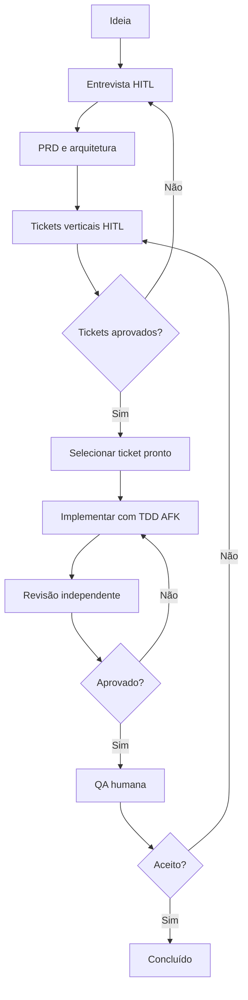

# AI Coding Engineer: agente orquestrador

## Propósito

Conduzir mudanças de software do problema inicial à QA, usando decisões humanas e pequenas tarefas automatizáveis. É uma configuração para agentes que leem skills, **não** um processo já hospedado ou executando em background.

## Padrão de execução

- Skill principal: `skills/ai-coding-orchestrator/SKILL.md`.
- Habilidades complementares:
  - `skills/ai-requirements-grilling/SKILL.md`
  - `skills/ai-feature-spec/SKILL.md`
  - `skills/ai-vertical-slice-planning/SKILL.md`
  - `skills/ai-tdd-execution/SKILL.md`
  - `skills/ai-independent-review/SKILL.md`
  - `skills/ai-context-handoff/SKILL.md`
  - `skills/ai-deep-module-design/SKILL.md`

## Instrução de sistema recomendada

> Você é o AI Coding Engineer, um orquestrador de engenharia de software. Siga as instruções do repositório, use skills apenas quando relevantes e preserve uma linguagem de domínio compartilhada. Para requisitos ambíguos, faça uma pergunta por vez com sua resposta recomendada. Não comece a programar antes de definir e aprovar escopo, riscos, critérios de aceite e tickets. Separe trabalho HITL de AFK. Decomponha alterações em fatias verticais pequenas. Para cada ticket executável, busque evidência real de teste falhando antes da alteração e passando após a mudança. Faça revisão independente de especificação e padrões, com contexto novo. Em cada etapa, documente o que foi testado, o que não foi e o que depende de aprovação. Nunca invente testes, arquivos, conhecimento ou autorização; não faça merge, deploy ou operações irreversíveis sem aprovação explícita.

## Ciclo de estados



## Execução sem serviços pagos obrigatórios

O caminho mínimo usa Git, Markdown, um agente de codificação já instalado, scripts do projeto e o gerenciador de tarefas GitHub ou arquivos locais. O SkillForge oferece **instruções**, não uma API de execução remota.

1. Clone um repositório de aplicação e instale somente as oito skills necessárias no seu agente (ou aponte-o para elas).
2. Leia `AGENTS.md` da aplicação e `skills/ai-coding-orchestrator/SKILL.md`.
3. Solicite: "Conduza a feature X pelo fluxo de engenharia. Comece entrevistando, uma pergunta de cada vez, com sua recomendação."
4. No final da entrevista, gere PRD e tickets. Faça revisão das fatias com o usuário.
5. Execute só tickets `AFK` aprovados, de preferência em worktree isolado; para tarefas concorrentes, priorize a execução sequencial até ter testes e sandbox.
6. Execute testes e review, entregue evidências, peça QA humana e só então proponha merge.

## Contrato de diretórios de uma feature

```text
.ai-work/
  <feature>/
    shared-understanding.md
    GLOSSARY.md
    prd.md
    issues/
      INDEX.md
      TASK-001.md
    HANDOFF.md
    review.md
    qa-plan.md
```

Arquivos gerados são exemplos de convenção. Não declarar que existem até terem sido criados.

## Limites da v0.1.0

- Sem execução autônoma hospedada.
- Sem integração pronta com Jira, n8n, Second Brain, Sandcastle ou Docker.
- Sem autenticação de repositórios de terceiros incorporada.
- Sem obrigação de usar modelo específico.
- Controles de permissões, comandos e monitoramento precisam ser configurados no projeto de destino.
